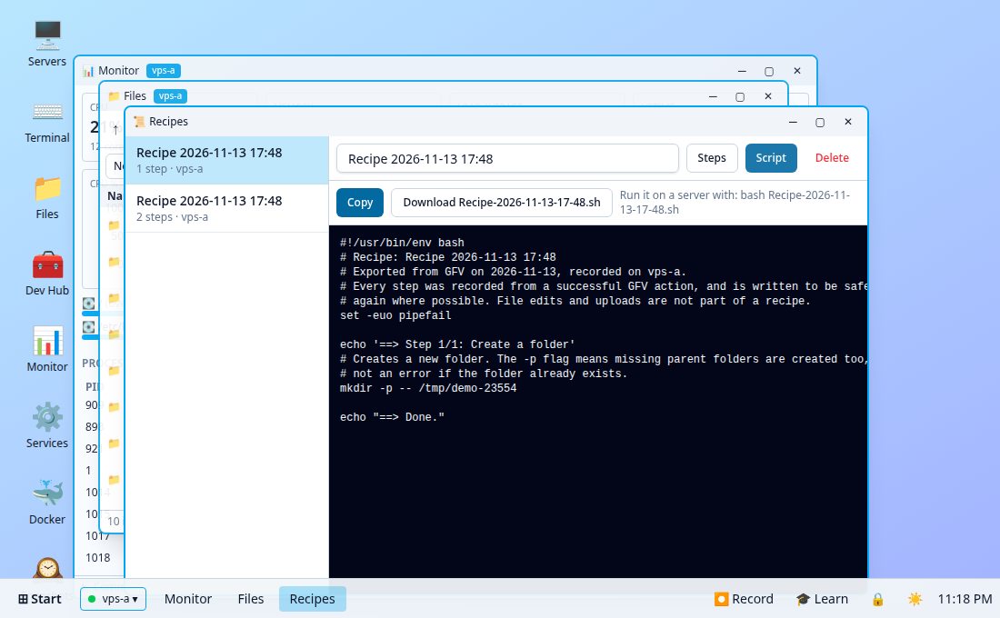

# GFV: a desktop in your browser for your VPS

GFV (a working name) gives you a desktop in the browser that is connected to your **real servers over SSH**:
windows, a taskbar, a terminal, a file manager, an editor, a system monitor, services, Docker and one-click
installs for the usual dev tools.


What makes it different from other server panels:

- **It teaches you (Learn Mode).** Every action shows the real command and a plain-English explanation of
  what it does, line by line. A journal keeps every command GFV ran for you, and "Try it yourself" types a
  command into a terminal without running it.
- **It protects you (Safety Net).** Risky actions (and risky commands you type in the terminal) are held until
  you confirm, with the reason. Before GFV overwrites a config file it backs the old version up on the
  server, and the Snapshots app shows a diff and restores it with one click. A restore can itself be undone.
- **It clones your setup (Recipes).** Press Record, do things in GFV, press Stop, and export what you did as
  a bash script with a comment explaining every step.

| Run an action: preview, real commands, risk | Monitor                      | Recipe export              |
| ------------------------------------------- | ---------------------------- | -------------------------- |
|                 |  |  |

## Install and run

You need Node.js 22 or newer on the computer you work on (not on the server).

```bash
npx gfv
```

GFV prints an address like `http://127.0.0.1:4310/?token=…` and opens it in your browser. The first time,
choose a **master password**: it encrypts your SSH keys and passwords on this computer. Then add a server and
take the short tour.

```
gfv [--port <n>] [--no-open] [--version] [--help]
```

Your data (servers, encrypted credentials, history, recipes) lives in `~/.gfv` (set `GFV_HOME` to change it).

## What is in it

| App           | What it does                                                                                         |
| ------------- | ---------------------------------------------------------------------------------------------------- |
| **Servers**   | Add servers (SSH key or password), verify host keys on first use, connect, test.                     |
| **Terminal**  | A real shell in the browser (xterm.js), multiple tabs, dangerous commands are held for confirmation. |
| **Files**     | Browse, upload (drag and drop), download, rename, permissions, delete.                               |
| **Editor**    | Monaco with syntax highlighting; "Save with sudo" for root-owned files, with a backup first.         |
| **Monitor**   | Live CPU, memory, network and disk charts; process list with stop / force kill.                      |
| **Services**  | systemd services: start, stop, restart, enable, disable, logs.                                       |
| **Docker**    | Containers and images: start, stop, restart, remove, logs.                                           |
| **Dev Hub**   | One-click install of Node.js, Python 3, Docker, PostgreSQL, nginx and Git on Ubuntu/Debian.          |
| **Snapshots** | Timeline of config backups with a diff and one-click restore.                                        |
| **Recipes**   | Recorded actions, editable, exported as a bash script.                                               |

Target systems: **Ubuntu and Debian** servers first.

## Security model

GFV is built to be run on **your own computer**:

- It listens on `127.0.0.1` only and requires a random session token on every request. Opening the printed
  address once turns the token into an `HttpOnly`, `SameSite=Strict` cookie. WebSocket origins are checked, and
  so is the origin of every request that changes something.
- SSH keys and passwords are encrypted at rest (AES-256-GCM, key derived from your master password with
  scrypt). The master password is never stored. Repeated wrong passwords are slowed down.
- Host keys are verified on first use (trust on first use). A changed key is never accepted silently.
- Every action goes through one **Command Runner**: parameters are validated and shell-quoted (never
  concatenated), risk is checked on the server, and what ran is recorded in your history.
- The Safety Net is a seatbelt for accidents, not a security boundary: shell syntax is too rich to parse
  perfectly (tab completion, history and aliases can bypass the terminal check).

Hosting GFV on a server for several users is not supported yet.

## Known limits

- Real systemd and Docker behaviour is covered by tests against canned output (the test containers have
  neither); verify on a real VPS before you rely on it.
- Recipes record **actions**: file edits, uploads and killed processes are not recorded, and recipes have no
  parameters yet. Replaying a recipe on another server is a future feature (export the script and run it).
- Logs refresh every couple of seconds (Follow); they are not a live stream.
- Shells in the Terminal end when the browser page is reloaded.

## Development

```bash
pnpm install
pnpm dev                 # server on 127.0.0.1:4310 + web on localhost:5173 (shared random token)
pnpm typecheck && pnpm lint && pnpm test
```

Two throwaway Ubuntu servers for the integration and end-to-end tests:

```bash
ssh-keygen -t ed25519 -N "" -f e2e/keys/id_test
docker compose -f e2e/docker-compose.yml up -d --build   # vps-a on port 2201, vps-b on 2202
pnpm test                # integration tests skip themselves if the containers are not running
pnpm e2e                 # Playwright: the built app against the test servers
```

`pnpm build:package` builds the publishable package into `dist-pkg/` (one bundled server file, the web app
and the migrations); `cd dist-pkg && pnpm pack` makes the tarball that `npx gfv` downloads.

Layout: `shared/` (types, Zod schemas, the action catalog, danger detector), `server/` (Fastify, SSH pool,
Command Runner, SFTP, SQLite), `web/` (React desktop and apps), `e2e/` (test servers and Playwright specs).
Read `PLAN.md` for the architecture and the milestones, and `CLAUDE.md` for conventions and gotchas.
