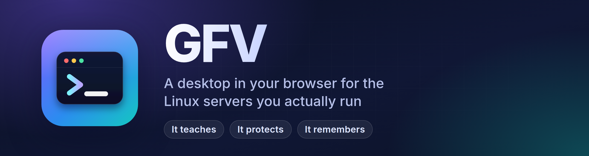
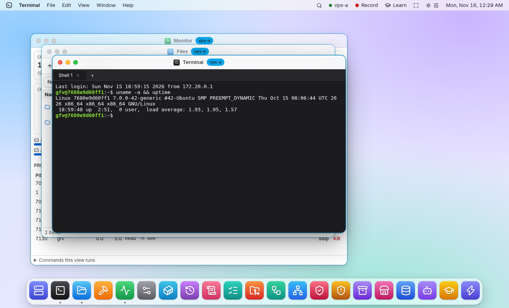
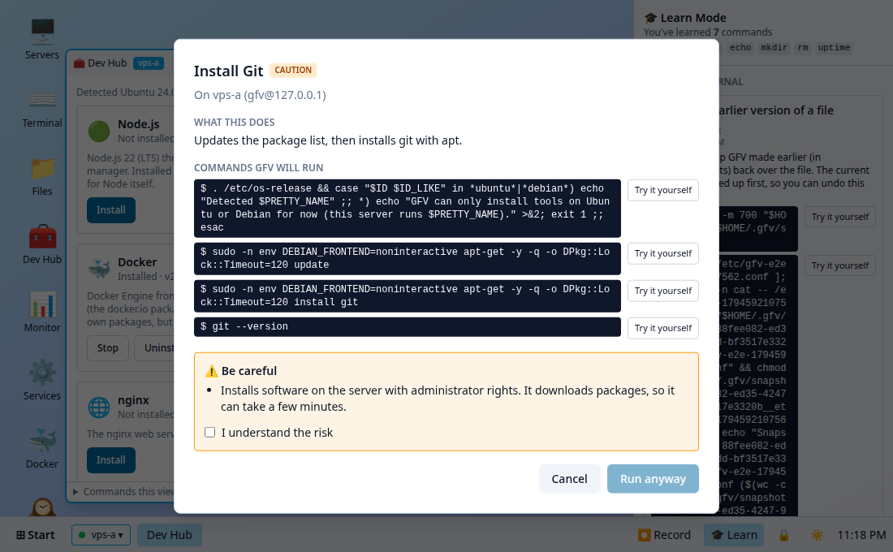
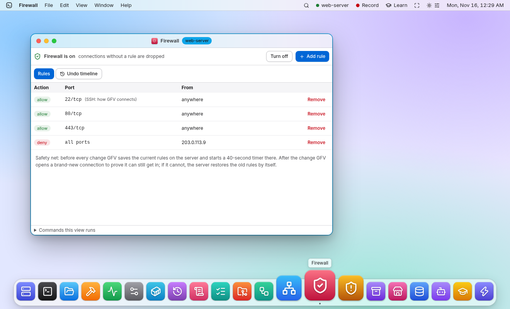
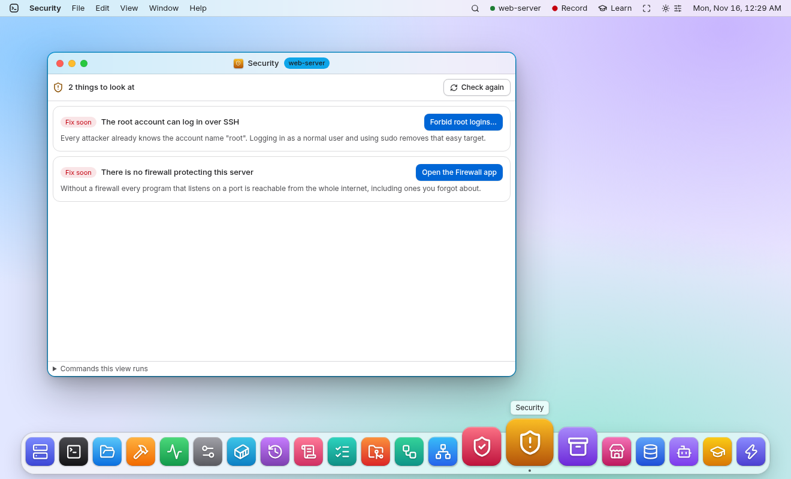
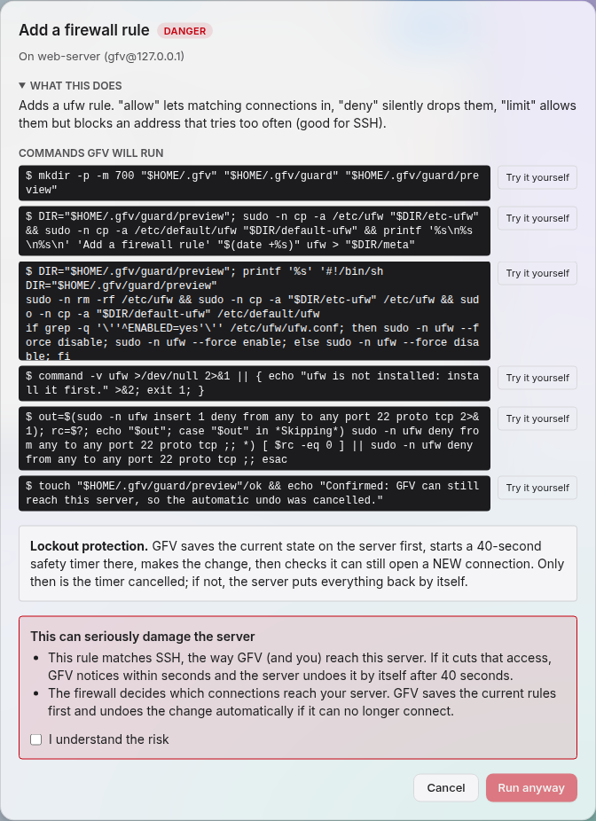
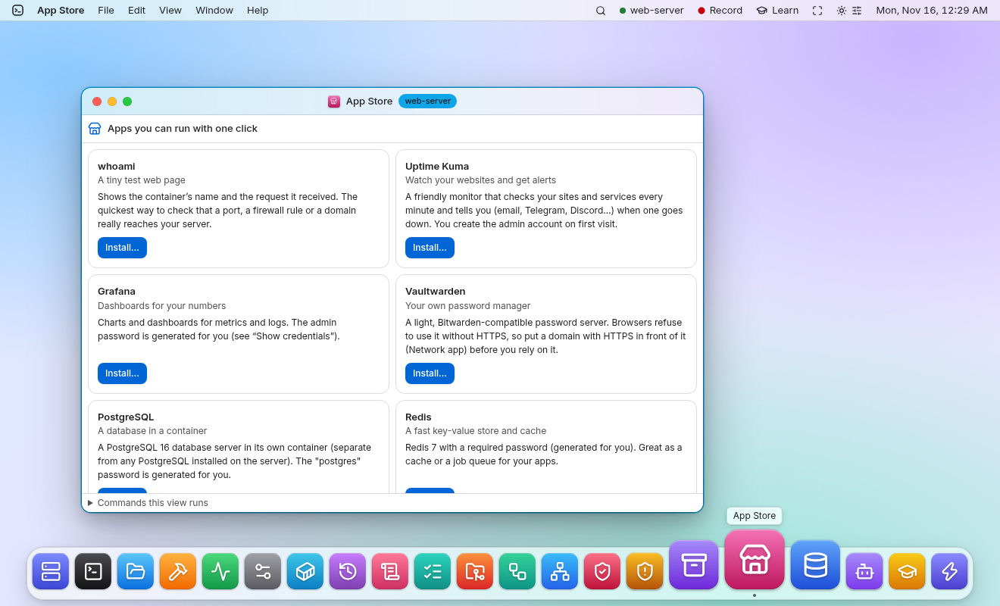
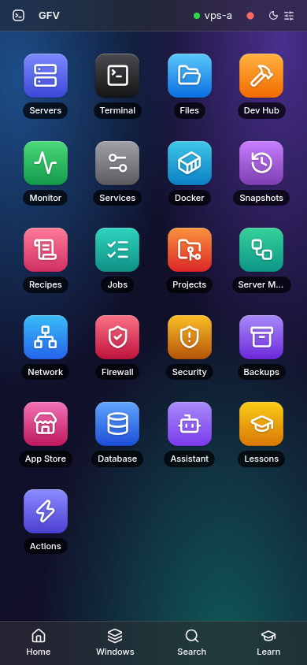

<p align="center">
  
</p>

<p align="center">
  <a href="https://github.com/Bittu-the-coder/gui-for-vps/actions/workflows/ci.yml"></a>
  <a href="LICENSE"></a>
  <a href="CONTRIBUTING.md"></a>
  <a href="https://www.npmjs.com/package/gui-for-vps"></a>
  
</p>

# GFV

A desktop in your browser for the Linux servers you actually run.

I built GFV because managing a small VPS usually means one of two things: memorising a pile of shell commands, or
trusting a control panel that hides what it does. I wanted a third option. GFV gives you windows, a dock, a
terminal, a file manager and a long list of server tools, and every time it changes something on a server it shows
you the exact command first and explains it in plain English. You get the convenience of a GUI and you still learn
what is happening underneath.

It runs on your own computer, connects to your servers over SSH, and installs nothing on them.


## What makes it different

I did not want to write another dashboard, so three ideas drive the whole project.

It teaches. Every action shows the real commands and a short explanation of what they do. A journal keeps every
command GFV has run for you, and "Try it yourself" types a command into a terminal without running it, so you can
learn by doing.

It protects. Risky actions, and risky commands you type into the terminal, are held until you confirm, with the
reason. Before GFV overwrites a config file it saves the old version on the server and lets you diff it and
restore it later. Changes that could lock you out of your own server, like a firewall rule that blocks SSH, are
guarded by a timer that lives on the server and undoes the change by itself if GFV cannot get back in.

It remembers. Press Record, do some work, press Stop, and export what you did as a bash script (or an Ansible
playbook, a Dockerfile or a Compose file) with a comment explaining each step. You can also replay a recipe on
other servers and watch each one's progress.

## Screenshots

| A working desktop                        | Run an action: preview, commands, risk |
| ---------------------------------------- | -------------------------------------- |
|  |            |

| Firewall with lockout protection           | The security checkup                                       |
| ------------------------------------------ | ---------------------------------------------------------- |
|  |  |

| What the lockout guard shows before it runs                    | App Store                                    | On a phone                           |
| -------------------------------------------------------------- | -------------------------------------------- | ------------------------------------ |
|  |  |  |

## What is in it

The apps live in a Dock, macOS style. Everything that changes a server goes through one place, the Command
Runner, which is what makes the teaching, the confirmations and the recipes possible.

- Terminal, file manager and editor (Monaco), with cross-server drag and drop
- Monitor, services (systemd) and Docker views
- Dev Hub: one-click installs of Node.js, Python, Docker, PostgreSQL, nginx and Git (Ubuntu, Debian and Fedora)
- Snapshots: a timeline of file backups with diffs and one-click restore
- Recipes: record, edit, export (bash, Ansible, Dockerfile, Compose), share as files, replay on several servers
- Network: listening ports, nginx sites, HTTPS through certbot
- Projects: deploy from git, environment variables, a systemd service, update checks
- Server Map: how a domain reaches your code, with broken links marked
- Firewall (ufw) with lockout protection and an undo timeline
- Security checkup with one-click fixes, and scheduled backups using real systemd timers
- App Store: a few well-known Docker apps, installed with generated passwords
- Database: browse and query PostgreSQL through an SSH tunnel, read-only unless you say otherwise
- Assistant: ask questions or have an error explained, with a preview of exactly what would be sent
- Lessons: guided practice on your real server
- A layout for phones and an installable app (PWA)
- A hosted mode with accounts, two-factor authentication, roles and an audit log, for running GFV on a server

The longer tour is in [docs/USER_GUIDE.md](docs/USER_GUIDE.md).

## Getting started

You need Node.js 22 or newer and pnpm on the computer you work from (not on the servers).

```bash
git clone https://github.com/Bittu-the-coder/gui-for-vps.git
cd gui-for-vps
pnpm install
pnpm start
```

`pnpm start` builds the web app, starts GFV and opens your browser. It prints an address like
`http://127.0.0.1:4310/?token=...`. Open it once and the token turns into a cookie. Stop GFV with Ctrl+C.

The first time you open it you choose a master password. It encrypts your SSH keys and passwords on your computer,
and there is no way to recover it if you forget it.

If you want to try GFV before pointing it at a real server, the repository includes throwaway Docker servers. The
instructions are in [docs/USER_GUIDE.md](docs/USER_GUIDE.md#try-it-without-a-server).

You can also run it without cloning anything. GFV is on npm as
[`gui-for-vps`](https://www.npmjs.com/package/gui-for-vps), and the command it installs is `gfv`:

```bash
npx gui-for-vps
# or install it once and run it any time
npm install -g gui-for-vps
gfv
```

The first install can take a couple of minutes, because GFV uses a native SQLite module that may need to be built
(on a fresh Ubuntu or Debian server, `sudo apt install build-essential python3` first if it complains).

If you want to reach GFV from anywhere instead of only from your own computer, run it on a VPS in hosted mode behind
nginx and HTTPS. [docs/HOSTED.md](docs/HOSTED.md) has the full step-by-step, including a free domain.

## Your data and your servers

GFV listens on 127.0.0.1 only and asks for a random token on every request. Credentials are encrypted at rest with
AES-256-GCM, using a key derived from your master password with scrypt. SSH host keys are checked the first time you
connect, and a changed key is never accepted silently. Nothing is sent anywhere unless you turn the assistant on and
press Send on a preview. There is no telemetry.

The Safety Net in the terminal is a seatbelt, not a security boundary. Shell syntax is too rich to parse
perfectly, so tab completion, history and aliases can get around it. The details are in
[SECURITY.md](SECURITY.md).

## An honest status

GFV is young, so here is what I have and have not proven.

I tested the risky parts against real systems, not mocks: a real firewall locking itself out and being restored by
the server, real systemd timers, real Docker, real PostgreSQL through an SSH tunnel, and real package installs on
Ubuntu and Fedora containers. The suite has a few hundred unit and integration tests and a browser test run that
drives the real interface.

I have not yet tested it against a large number of real, different servers. I have not run the assistant against the
real Anthropic API or a real Ollama install, only against fake servers that speak the same protocol. I have set hosted mode up
once on a real Azure VPS behind nginx and a Let's Encrypt certificate, and signing in and using it worked, but that is
one deployment, and nobody besides me has reviewed its security. If you
want to use hosted mode for anything important, please read [docs/HOSTED.md](docs/HOSTED.md) first and review it
yourself.

Ubuntu and Debian are the main targets. Fedora works for the Dev Hub and a few other features. Alpine, Arch and the
Fedora firewall (firewalld) are not supported yet.

## Contributing

I would really like help, and you do not need to be an expert. Bug reports with the steps to reproduce them are
valuable. So is trying GFV on a distribution or a provider I have not, and telling me what broke.

Start with [CONTRIBUTING.md](CONTRIBUTING.md). It explains how to run the project, how the code is organised, and
what I look for in a pull request. [docs/HOW_IT_WORKS.md](docs/HOW_IT_WORKS.md) is a long tour of how everything is
wired, and [docs/ROADMAP.md](docs/ROADMAP.md) lists what I would like to build next, including a few good first
issues.

If you find a security problem, please do not open a public issue. [SECURITY.md](SECURITY.md) says how to reach me.

If GFV is useful to you, a star on the repository helps other people find it.

## Project layout

- `shared/` holds the types, the Zod schemas and the catalogue of actions. Both the server and the browser use it.
- `server/` is a Fastify server with the SSH pool, the Command Runner, SFTP and a SQLite database.
- `web/` is the React desktop and its apps.
- `e2e/` holds the Docker test servers and the Playwright specs.
- `docs/` holds the guides and the architecture notes.

## License

GFV is released under the GNU Affero General Public License v3.0 (AGPL-3.0-only). See [LICENSE](LICENSE).

In plain words: you can use, study, change and share GFV freely. If you modify it and let other people use your
modified version over a network, for example as a hosted service, the AGPL requires you to offer them your source
code under the same license. Using GFV to manage your own servers needs nothing extra.

If you want to use GFV in a way the AGPL does not fit, such as building it into a closed-source product or offering it
as a hosted service without publishing your changes, a commercial license is available. See
[COMMERCIAL-LICENSE.md](COMMERCIAL-LICENSE.md).

Versions 0.1.0 and 0.1.1 were released earlier under the MIT license, and that license stays valid for those versions.
Version 0.2.0 and later are AGPL-3.0.
